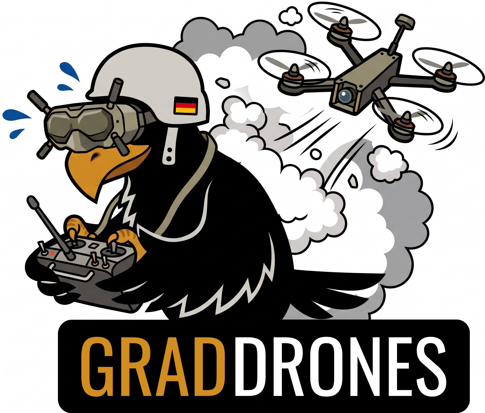

# What is it?

**Gruppe Adler Drones** enhances on the Vanilla Arma drones and its 2035 assets. 

It intends to bring the capability of drones closer to those of our current real-life drone age.

# What does it do?
For starters it only modifies the AR-2 Darter drones.

- The `sound` sub-module makes the **exterior sound of the Darter much louder**.
- The `attack` sub-module allows for creation of:
  - **demolition drones** as Zeus (or via script).
  - **suicide waypoints** as Zeus (or a script)
    - When those are reached, drones lock onto visible targets and steer themselves into them.
- The `uav_link` sub-module let's the drone video signal deteriorate with distance (when using the UAVTerminal).

# Contribution
Suggestions and PRs are welcome. 
