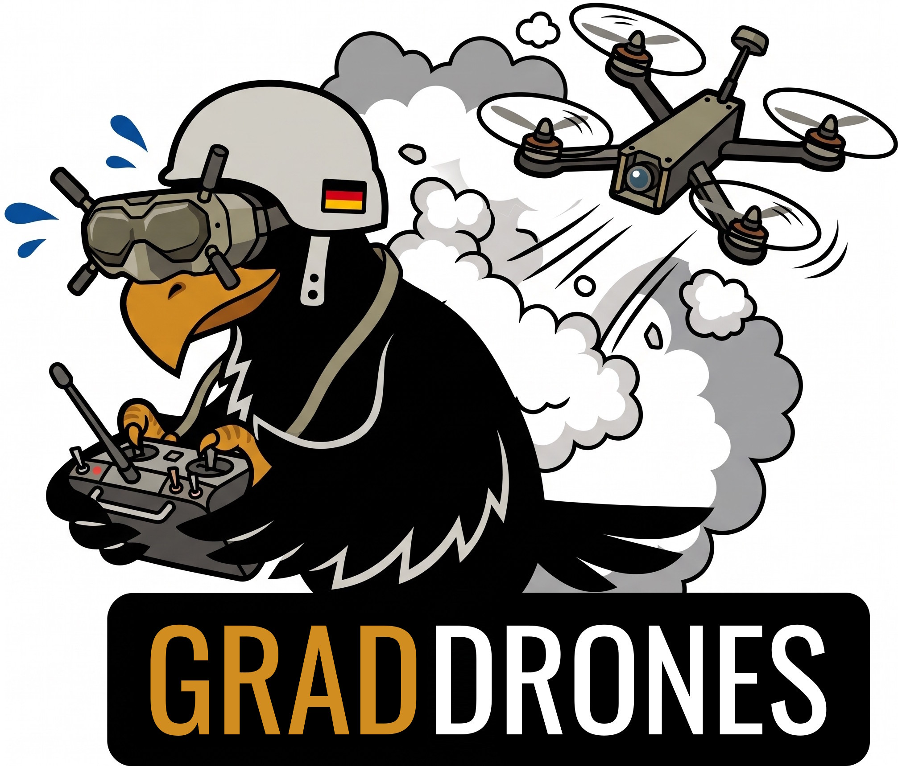

# What is it?

**Gruppe Adler Drones** enhances on the Vanilla Arma drones and its 2035 assets. 

It intends to bring the capability of drones closer to those of our current real-life drone age.

# What does it do?
For starters it only modifies the AR-2 Darter drones.

- The `sound` sub-module makes the **exterior sound of the Darter much louder**.
> - The **suicide drones** functionality, that is currently only part of [COOP mission Just Expedition](https://github.com/gruppe-adler/CO_Just_Expedition.Altis/tree/main/scripts/util/functions), will be ported later to be part of `grad_drones` then.
>   - It allows to create **demolition drones** as Zeus (or via script).
>   - In addition Zeus (or a script) can create **suicide waypoints**, that when reached let drones lock on to visible targets and steer themselves into them.

# Contribution
Suggestions and PRs are welcome. 
